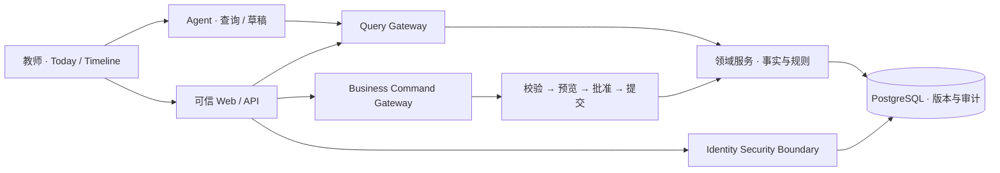

<div align="center">

<h1>班事有谱 · ClassMatter</h1>

<p><strong>班里的事，记得住、跟得上、查得到。</strong></p>

<p>面向班主任的 <strong>Agent-native Personal Class OS</strong><br>把零散的班级事务，变成有上下文、能跟进、可追溯的工作记忆。</p>

<p>
<a href="README_EN.md">English</a> ·
<a href="#-产品理念">产品理念</a> ·
<a href="#-产品能力">产品能力</a> ·
<a href="#-系统设计">系统设计</a> ·
<a href="#-快速开始">快速开始</a> ·
<a href="#-项目文档">项目文档</a>
</p>

<p>
<a href="LICENSE"></a>
<a href=".github/workflows/synthetic-ci.yml"></a>

</p>

</div>

---

## ✦ 为什么是班事有谱？

班主任每天处理的，不只是“数据”，而是一件件**有前因、有后续、有人负责**的事。

一次请假、一次谈话、一条通知、一项需要持续跟进的安排——它们分散在聊天、表格、纸笔和个人记忆里。难的往往不是记下一句话，而是过几天还能回答：

**发生了什么？接下来做什么？谁来跟进？做到哪一步？依据在哪里？**

> **ClassMatter 想成为班主任的外置工作记忆。** 不增加一套孤立的台账，而是让一次记录自然连接到后续行动，让重要的事都有下文。

<div align="center">

**记录事实　→　关联任务　→　Today 跟进　→　Timeline 回看　→　更正与审计**

</div>

## ✦ 产品理念

我们不以功能数量定义产品，而是坚持六条共同的设计原则。

| | |
| :--- | :--- |
| **01 · 以事为中心** <p>不是另一张表</p> | 让记录、对象、时间、来源、行动和结果彼此关联。一件事应当能持续跟进，而不是录入后就被遗忘。 |
| **02 · 降低被动责任压力** <p>不止是少做几步</p> | 关心通知洪流、责任不清、无人承接和事后追溯。明确事项来源、确认后的责任、期限、交接与完成依据；不把收到消息等同于接受责任。 |
| **03 · 尊重事实的边界** <p>知道与猜测是两回事</p> | 正式事实、观察、主张、证据、AI 推断与草稿具有不同权威。模型的推测不能自动变成关于学生的正式事实。 |
| **04 · AI 辅助，人来决定** <p>智能不等于越权</p> | Agent 理解意图、检索与起草；领域规则、权限、风险评估、批准和写入由受控系统负责。即使 AI 不可用，核心流程依然工作。 |
| **05 · 稳定内核，持续生长** <p>不是一口气造完 ERP</p> | 从 Stable Kernel 到 Domain Pack，再到受治理的 Controlled Extension。让新业务接入既有语义，而不是无限堆砌独立模块。 |
| **06 · 追求净减负** <p>别让自动化制造新负担</p> | 不只计算录入时间，也衡量核对、纠错、待审队列、学习与维护成本。没有持续净价值的功能，就应该调整甚至删除。 |

<details>
<summary><strong>深入一点：为什么不把所有信息都交给 Agent 的 Memory？</strong></summary>

因为 **Context、Memory、Knowledge/RAG 与 Domain Fact 不具有相同的权威性**。对话和检索可以帮助理解，正式业务事实则必须有确定的来源、范围、版本与更正机制。

在班事有谱的长期模型中，事实、观察、推断和草稿被有意区分；来源失效时，相应的派生信息也应失效或重建。详见 [长期演进需求](docs/specs/class-os-v1/long-term-requirements.md) 与 [架构决策](docs/specs/class-os-v1/architecture-decision.md)。

</details>

## ✦ 产品能力

**独立 PC Demo：** 已新增 Windows x64 桌面宿主，复用现有前端，打包后不依赖浏览器或本地 Web 服务。当前仅合成演示，不是完整本地 Agent，也不连接数据库/真实模型。见[桌面运行与打包](apps/desktop/README.md)。

### 从一件班务开始，形成完整的工作闭环

| 工作场景 | 已有的工程实现 |
| :--- | :--- |
| **班级与学生** | 本机单 owner 工作空间、登录、班级/学期与学生名单 |
| **日常事实** | 类型化事实事件、稳定标识、来源与时间上下文 |
| **跟进与回看** | Task、Today 工作视图、Student Timeline |
| **可信变更** | 更正预览、必要的人工批准、版本与事务审计 |
| **AI 工作入口** | 可替换的 Pydantic AI 查询/草稿能力；不开放 Agent 自主批准与正式写入 |

这些能力对应真实代码、数据库迁移、契约与合成数据回归测试，而不只是 UI 概念稿。

### 一套面向完整班级工作的产品蓝图

**班务管理**　名单和成绩导入、成绩分析、座位/宿舍安排、分组和值日  
**协同与表达**　工作报告、家校沟通草稿、任务交接、Case / Commitment / Workflow  
**智能与扩展**　多渠道 Capture、实体解析、Knowledge/RAG、可治理的领域扩展

上述模块属于 [完整 v1 业务设计](docs/specs/class-os-v1/requirements.md) 与 [长期方向](docs/specs/class-os-v1/long-term-requirements.md)。**产品蓝图不等于当前版本全部交付**；我们选择先把“记录—跟进—回看”做好，再向外扩展。

### 从日常跟进到异常事件协同：为什么要把“过程”留下来？

班主任面对的不只是待办，还有一些**已谈话但待复访、已告知但未确认接收、已发生但后续仍需观察**的开放事项。真正可靠的系统要区分“已经记录”和“已经履职”、区分“消息已发送”和“责任已被确认接手”。

我们正在把这一类真实的业务原型整理成可讨论、可验证的设计：从请假未归、家校沟通、学生冲突、寄宿管理，到需要专业介入的学生异常情况。目标是降低**可避免的遗漏与交接断裂**，让处置过程可追溯，而不是承诺预测每一次事故或让教师自动免责。

- [20 个班务与异常场景：业务场景目录](docs/product/scenario-catalog.md)
- [学生安全、履职留痕与组织交接：未来工作流](docs/product/student-safety-and-duty-workflows.md)

> **版本边界：** 以上是 Discovery / Future 业务设计。当前 R1 只验证非敏感事实、个人任务、Today/Timeline 的最小闭环；不处理学生心理健康等 D4 数据，不提供校级多角色交接、自动预警或紧急处置能力。任何真正的紧急事件都必须先按学校正式预案线下处理。

**法律与制度依据：** 高风险业务先核对有效法律、行政法规、地方法规/规章与正式校规，并分别参考司法解释、指导性案例和其他生效类案；记录条款、地域、时效、职责与复核状态，不能凭 AI 推断责任。[规则依据层级与追溯机制](docs/product/legal-evidence-and-rule-hierarchy.md)。

## ✦ 系统设计

### Agent-native，但事实与权限不交给模型



**模型负责理解，领域负责规则，教师保留决定权。**

| 层次 | 技术与设计 |
| :--- | :--- |
| **Web** | React 19 · TypeScript · Vite · Tailwind CSS |
| **Backend** | Python 3.13 · FastAPI · PostgreSQL 18 |
| **AI** | Pydantic AI · Tool / Provider Adapter · 只读与草稿边界 |
| **架构** | 分层模块化单体 · QG / BCG / ISB · 幂等与审计 |
| **质量** | 合约与 Eval · 真实隔离数据库回归 · Windows / Ubuntu CI |

[架构全图](docs/specs/class-os-v1/architecture.md) · [ADR 决策记录](docs/specs/class-os-v1/architecture-decision.md) · [工程与数据流](docs/ENGINEERING_OVERVIEW.md)

## ✦ 快速开始

目前的本机持久化运行入口面向 **Windows**，依赖 PowerShell 7、Node.js 22–24、pnpm 11.19.0、Python 3.13、uv 0.11.7 和 PostgreSQL 18.6 binaries；本机凭据使用 DPAPI。

```powershell
# 构建 Web
cd apps/web
pnpm install --frozen-lockfile
pnpm typecheck
pnpm build

# 初始化并启动
cd ../../backend
uv sync --frozen
uv run --frozen python local.py init --pg-root '<PostgreSQL18安装目录>'
uv run --frozen python local.py start
uv run --frozen python local.py bootstrap
uv run --frozen python local.py serve
```

浏览器打开 **http://127.0.0.1:8000**。运行结束后可执行 `uv run --frozen python local.py stop`。请在交互终端妥善保管密码和恢复码，勿将运行目录或真实学生资料提交到仓库。

<details>
<summary><strong>验证命令、Demo 模式与适用边界</strong></summary>

```powershell
python scripts/public_guard.py --require-license
pwsh ./scripts/verify.ps1 -Suite docs
pwsh ./scripts/verify.ps1 -Suite web
pwsh ./scripts/verify.ps1 -Suite backend
pwsh ./scripts/verify.ps1 -Suite all -PostgresRoot '<PostgreSQL18安装目录>'
```

`all` 需要相应的 PostgreSQL、浏览器与技术测试依赖。单独的 Vite 不是持久化后端；`VITE_CLASS_OS_DEMO=true` 是合成数据 mock 模式。旧实例升级需要显式迁移，不要跨设备复制 `.local-runtime/`。

当前公开版本为 **Pre-alpha · Synthetic Development**：代码与工程闭环可供研究和复现；真实学生数据、生产部署、正式 R1 和完整退出/恢复需单独准入，不会因为源码公开或 CI 通过而自动获得授权。

</details>

## ✦ 项目文档

| 你想了解 | 从这里开始 |
| :--- | :--- |
| **产品要解决什么问题** | [需求](docs/specs/class-os-v1/requirements.md) · [业务流程](docs/specs/class-os-v1/business-flow.md) |
| **为什么这样设计** | [架构](docs/specs/class-os-v1/architecture.md) · [架构决策](docs/specs/class-os-v1/architecture-decision.md) |
| **理念如何延伸为完整系统** | [长期需求](docs/specs/class-os-v1/long-term-requirements.md) · [验收与价值标准](docs/specs/class-os-v1/acceptance.md) |
| **怎样贡献与验证** | [贡献指南](CONTRIBUTING.md) · [安全说明](SECURITY.md) · [公开审计](docs/PUBLIC_AUDIT.md) |

---

<div align="center">

<strong>不是让班主任记住更多，而是让重要的事都有下文。</strong>

<p><sub>Open Source · Apache-2.0 · Copyright © 2026 Gdnbit<br>
<a href="LICENSE">License</a> · <a href="NOTICE">Notices</a> · <a href="README_EN.md">English</a></sub></p>

</div>
