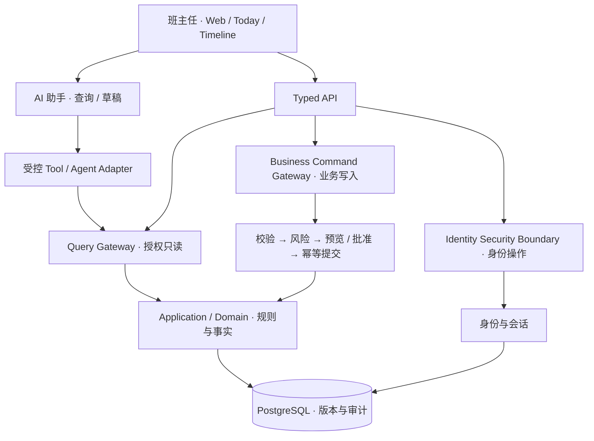

# 班事有谱 · ClassMatter

**班里的事，记得住、跟得上、查得到。**

**一个面向班主任日常工作的 Agent-native Personal Class OS。** 让散落在聊天、表格、纸笔和记忆里的班级事务，逐渐成为有上下文、能跟进、可追溯、可迁移的个人工作系统。

[English](README_EN.md) · [产品理念](#我们相信的六件事) · [产品能力](#从记录一件事到管理整个班级) · [架构设计](#agent-native但不把业务交给模型碰运气) · [快速开始](#快速开始) · [项目文档](#文档导航)

> **Open Source · Pre-alpha · Apache-2.0** — 当前开放的是可运行的合成数据开发版本。项目以完整产品愿景持续演进；真实学生数据与生产场景仍须单独完成准入，不应直接用于正式管理。

## 为什么是「班事有谱」？

班主任的工作往往不是缺少一个能填表的软件，而是缺少一个真正理解「班里的事如何发生、推进和结束」的工作系统。

一次请假、一次迟到、一次谈话、一次未交作业，表面上都是一条记录。但事情不会停在记录那一刻：是否需要跟进？跟进由谁完成？期限是什么？后来有没有变化？如果明天再问起这件事，能不能准确还原过程？

现实里，这些信息经常散落于 Excel、聊天记录、纸质材料、备忘录，以及班主任自己的脑海中。结果是：

- **信息分散：** 知道发生过什么，却需要到处翻找才能拼出完整经过。
- **行动分散：** 记录、待办、后续结果彼此脱节，容易出现「记下了，但忘了继续处理」。
- **责任分散：** 一条通知、一项安排和一个明确的责任承诺不是一回事，却很容易在消息洪流中混在一起。
- **上下文断裂：** 时间久了、学期变了、人员更替了，事情的缘由、版本和处理依据难以传递。

**ClassMatter 的出发点，不是让教师多录入一套系统，而是让已经付出的记录和处理成本能够被持续复用。**

## 我们相信的六件事

### 01 · 管理的最小单位是「一件事」，不是一张表

表格擅长保存某个时刻的数据，但班级工作是动态的：一件事有发生时间、涉及对象、记录者、来源、关联任务、后续状态和处理结果。

因此我们以**事实事件与任务的关系**作为第一条业务主线：

```text
发生了一件事
  → 留下有类型、有时间、有来源的记录
  → 需要行动时形成可跟进的任务
  → 在 Today 看到下一步
  → 在 Student Timeline 找到过去与现在的关联
  → 必要时更正，并保留版本和处理痕迹
```

我们不是简单地把纸质台账搬到网页上，而是尝试让信息从一次性记录变成可继续工作的上下文。

### 02 · 不只是「减轻工作量」，更要减少被动责任压力

班主任的负担不仅来自任务数量，也来自通知洪流、责任不清、无人承接、期限模糊、遗漏风险和事后难以说明处理经过。

ClassMatter 的产品优先级因此不是「哪个功能看起来更智能」，而是首先回答：

**这是什么事？为什么需要处理？谁真正负责？什么时候需要动作？现在处于什么状态？交接到哪里？证据在哪里？**

我们把**事项来源、行动要求、确认后的责任主体、期限、状态、交接/升级与完成依据**作为长期工作流的重要语义。系统帮助理解和留痕，但不会把别人发来的一条消息自动变成班主任已经接受的责任，也不会替学校或制度判定法律责任。

这使班事有谱更接近**工作记忆与责任协作基础设施**，而不只是提醒器。

### 03 · 事实、观察、推断和建议，不应该混成一种「记忆」

「发生过一次迟到」是记录；「近期可能需要关注」是判断；「AI 觉得某位学生存在某种问题」是推断。它们不是同一种东西。

我们在领域设计里区分 **Domain Fact / Observation / Claim / Evidence / Derived Signal / AI Inference / Draft**。每一类信息都应有自己的来源、状态、适用范围与生命周期。

尤其是：**模型的推测不能因为被说出来、被总结过或被存进聊天记忆，就自动升级成关于一个人的正式事实。**

同样，Context、Conversation Memory、Knowledge/RAG 与业务事实各自有不同的权威边界。系统应该知道自己「知道什么、根据什么知道、什么时候可能已经过期」。

### 04 · AI 应该理解工作，但不拥有最终决定权

我们希望 AI 能听懂教师的意图，帮助查找上下文、理解事项、组织信息、起草下一步；而不是让模型绕过校验直接修改数据库。

ClassMatter 把**理解与执行分开**：

- AI 擅长理解自然语言、解释信息与组织草稿。
- 领域服务负责确定性规则、身份归属、版本和数据一致性。
- 可信操作入口负责范围、权限、风险、预览与必要的人类批准。
- 审计记录负责说明发生了什么，而不是靠模型事后回忆。

**Agent 是参与工作的助手，不是事实源、授权者或数据库管理员。**

更重要的是：即使模型离线、接口失效，教师仍能通过结构化 UI 完成核心业务。这不是「AI 功能失效时的妥协」，而是我们对可靠工作系统的基本要求。

### 05 · 一个好系统应该能生长，而不是从第一天就变成庞大的 ERP

班级事务有很多：出勤、作业、谈话、成绩、座位、宿舍、职务、分组、值日、报告、家校沟通……把每种业务写成一套孤立功能，最终只会制造新的信息孤岛。

我们的长期方向是**可演进的开放领域模型**：

```text
Stable Kernel（身份、范围、时间、来源、事实与权限）
        ↓
Domain Pack（班级、记录、任务、成绩、排座等具体业务）
        ↓
Controlled Extension（经过校验与授权的受控扩展）
        ↓
Promotion（验证稳定后纳入正式领域能力）
```

先复用已有语义，再引入新领域；扩展可以灵活，但不能把一切塞进万能 JSON 表，更不能允许 Agent 随意修改数据库 Schema。Workflow、OCR、ASR、RAG、求解器与模型 Harness 都应是可替换能力，不决定业务真相和权限。

我们选择**稳定核心 + 可控演进**，而不是「一开始什么都有」或「让 AI 想怎么改就怎么改」。

### 06 · 功能的价值要看「净减负」，不是看演示时省了几步

自动录入可能节省输入时间，却产生更多核对成本；自动提醒可能避免遗漏，却制造新的通知；AI 总结可能省下整理时间，却让人不得不逐字验证。

所以我们希望用真正的 **Net Burden（净负担）** 来评价系统：录入时间、核对纠错、未完成队列、上手与持续维护成本，以及错误、隐私与运维风险。

**一个功能如果长期没有带来净收益，就应该被缩小、重新设计，甚至删除。**

这条原则也约束 AI：我们不是为了接入更多模型、更多 Agent、更多自动化而开发，而是为了让实际工作更轻、更清晰、更可控。

## 从记录一件事，到管理整个班级

ClassMatter 的产品版图由一条可用的日常事务闭环向外生长。

| 工作场景 | 我们希望建立的能力 |
| --- | --- |
| **班级与学生** | 围绕工作空间、班级、学期和稳定学生标识形成一致的工作上下文 |
| **日常事实** | 记录请假、迟到、缺勤、表扬、谈话与作业相关事实，区分来源和发生时间 |
| **任务与 Today** | 把需要跟进的事项变成明确的下一步，而不是静态备注 |
| **Student Timeline** | 沿着学生与事件的时间线还原事实、任务及处理进展 |
| **更正与审计** | 数据可更正，过程可追溯；通过预览、版本和必要的批准控制修改 |
| **Agent 工作入口** | 基于获授权的事实进行查询、解释与草稿生成，不替教师直接作出正式决定 |
| **长期扩展方向** | 经过独立设计与准入的成绩分析、排座、宿舍、报告、沟通、Capture 和多角色协作 |

### 当前已经落地的工程切片

公开代码包含**单 owner 本地工作空间、班级/学期/名单、类型化事实事件、简单任务、Today、Student Timeline、更正预览与批准、版本化审计**以及可替换的 **Pydantic AI 查询/草稿适配层**。

这条业务主线不是只写在产品文档里；仓库包含前后端、数据库迁移、HTTP 与工具契约，以及覆盖关键操作的合成数据测试。它也是我们向更多班级工作场景扩展的基础。

### 下一阶段如何生长

完整 v1 的业务设计涵盖名单和成绩导入、确定性成绩分析、约束排座、宿舍调整、报告与家校沟通草稿、导出和生命周期管理。

更长期的方向则涉及 Channel/Capture、多来源实体解析、Memory/Knowledge、Case/Commitment/Workflow、角色协作与受控领域扩展。

**这些是完整产品蓝图中的明确模块，不应与当前最小切片混为「全部已上线」。** 设计与具体适用范围分别见 [Requirements](docs/specs/class-os-v1/requirements.md)、[Business Flows](docs/specs/class-os-v1/business-flow.md)、[Long-term Evolution](docs/specs/class-os-v1/long-term-requirements.md) 和 [R1 Manifest](docs/specs/class-os-v1/release-1-manifest.md)。

## Agent-native，但不把业务交给模型碰运气

我们把对话理解与可信业务能力之间的边界当作**产品架构的一部分**，而不是后期加几条 Prompt。



这套边界服务于几个长期原则：**业务读写分流、最小权限、事实可追溯、变更可验证、模型可替换、核心流程不依赖 AI 在线**。

技术选择也服从产品规模与维护成本：目前采用 **React 19 / TypeScript / Vite / Tailwind CSS** 前端，**Python 3.13 / FastAPI / PostgreSQL 18** 后端，使用**分层模块化单体**而不是过早拆分微服务。Agent 通过 Pydantic AI 的适配层接入；内部 `class_os` 技术命名保留以维持兼容。

设计取舍与证据见 [Architecture](docs/specs/class-os-v1/architecture.md)、[Architecture Decisions](docs/specs/class-os-v1/architecture-decision.md) 和 [Engineering Overview](docs/ENGINEERING_OVERVIEW.md)。

## 快速开始

当前持久化本机入口面向 **Windows**，使用本机 DPAPI 管理运行时凭据。准备 PowerShell 7、Node.js 22–24、pnpm 11.19.0、Python 3.13、uv 0.11.7 和 PostgreSQL 18.6 binaries。

```powershell
cd apps/web
pnpm install --frozen-lockfile
pnpm typecheck
pnpm build

cd ../../backend
uv sync --frozen
uv run --frozen python local.py init --pg-root '<PostgreSQL18安装目录>'
uv run --frozen python local.py start
uv run --frozen python local.py bootstrap
uv run --frozen python local.py serve
```

打开 **http://127.0.0.1:8000**。凭据与恢复码请在交互终端妥善保管，不要放进 Git。停止服务可运行 `uv run --frozen python local.py stop`。

单独启动 Vite 不是完整持久化服务；`VITE_CLASS_OS_DEMO=true` 是显式开启的合成 mock 演示模式。已有实例升级需要单独执行版本迁移，不要跨机复制 `.local-runtime/`。

## 工程验证与项目阶段

```powershell
python scripts/public_guard.py --require-license
pwsh ./scripts/verify.ps1 -Suite docs
pwsh ./scripts/verify.ps1 -Suite web
pwsh ./scripts/verify.ps1 -Suite backend
pwsh ./scripts/verify.ps1 -Suite all -PostgresRoot '<PostgreSQL18安装目录>'
```

仓库有 Windows / Ubuntu GitHub Actions、依赖锁定、业务与契约测试、隔离 PostgreSQL 与浏览器回归，以及逐文件 SHA-256 的公开内容白名单。验证详情见 [Public Audit](docs/PUBLIC_AUDIT.md)。

当前开源版本是 **Pre-alpha / Synthetic Development**。它是一套持续演进的工程项目，而非允许接入真实学生数据的正式学校系统。真实数据、正式试点与生产部署需独立完成安全、治理、退出及价值准入；尚未实现的能力按产品路线逐步进入，而不通过文档宣称完成。

## 文档导航

| 想了解什么 | 阅读 |
| --- | --- |
| 产品范围、优先级和功能 | [Requirements](docs/specs/class-os-v1/requirements.md) · [Business Flows](docs/specs/class-os-v1/business-flow.md) |
| 我们如何定义净减负和产品价值 | [Acceptance & Value Gates](docs/specs/class-os-v1/acceptance.md) · [Long-term Requirements](docs/specs/class-os-v1/long-term-requirements.md) |
| 领域模型与 Agent 系统设计 | [Architecture](docs/specs/class-os-v1/architecture.md) · [ADR](docs/specs/class-os-v1/architecture-decision.md) |
| 现在可运行的业务切片 | [Release 1 Manifest](docs/specs/class-os-v1/release-1-manifest.md) · [Engineering Overview](docs/ENGINEERING_OVERVIEW.md) |
| 参与与贡献 | [CONTRIBUTING](CONTRIBUTING.md) · [SECURITY](SECURITY.md) · [Backend](backend/README.md) |

---

**班事有谱想做的，不是让班主任记住更多事，而是让值得记住的事、需要继续做的事，都有迹可循。**

自有源码以 [Apache-2.0](LICENSE) 开源，Copyright 2026 Gdnbit；第三方许可见 [NOTICE](NOTICE) 与 [THIRD_PARTY_NOTICES](THIRD_PARTY_NOTICES.md)。此仓库是独立公开版本，不继承原私有开发仓库的历史或私人研究资料；新增素材和代码请先完成公开内容审查。
