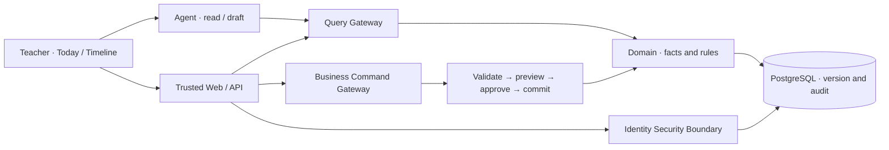

<div align="center">

<h1>ClassMatter · 班事有谱</h1>

<p><strong>Every class matter matters.</strong></p>

<p>An <strong>Agent-native Personal Class OS</strong> for homeroom teachers.<br>Turn scattered records and follow-ups into coherent, traceable working memory.</p>

<p>
<a href="README.md">简体中文</a> ·
<a href="#-product-philosophy">Philosophy</a> ·
<a href="#-capabilities">Capabilities</a> ·
<a href="#-system-design">Architecture</a> ·
<a href="#-quick-start">Quick Start</a> ·
<a href="#-documentation">Docs</a>
</p>

<p>
<a href="LICENSE"></a>
<a href=".github/workflows/synthetic-ci.yml"></a>

</p>

</div>

---

## ✦ Why ClassMatter?

A homeroom teacher manages more than forms and spreadsheets. An absence, conversation or new instruction may lead to a follow-up, deadline, handoff or later correction.

The real challenge is often **fragmented information, disconnected actions, unclear responsibility and lost context**.

> **ClassMatter is an external working memory for class affairs.** Instead of creating another ledger to maintain, we want every record to become a useful starting point for the next action.

<div align="center">

**Record → Task → Today → Student Timeline → Correction & Audit**

</div>

## ✦ Product philosophy

Six principles shape how ClassMatter works and how it grows.

| | |
| :--- | :--- |
| **01 · Work around the matter** <p>Not another table</p> | Connect records, subjects, sources, time, tasks and outcomes. A matter should remain actionable after its first entry. |
| **02 · Reduce passive responsibility pressure** <p>More than fewer clicks</p> | Clarify what needs action, why, who owns it, when it is due and where the evidence lives. An incoming message is not an accepted responsibility. |
| **03 · Keep epistemic boundaries** <p>Evidence is not inference</p> | Domain Fact, Observation, Claim, Evidence, AI Inference and Draft are not interchangeable. Chat memory must not turn a hypothesis into a formal fact. |
| **04 · AI helps; people decide** <p>Assistance is not authority</p> | The Agent can retrieve, explain and draft. Trusted gateways own permissions, deterministic rules, risk, approval and committed changes. |
| **05 · Grow from a stable core** <p>Governed, not improvised</p> | Evolve from Stable Kernel through Domain Packs and Controlled Extensions; no unbounded fact table or Agent-driven schema mutation. |
| **06 · Optimize for net burden** <p>Not demo speed</p> | Measure review, error correction, backlog, onboarding and maintenance alongside time saved. Remove automation that does not deliver net value. |

**The goal is not to make teachers remember more. It is to give important work a reliable place to live.**

<details>
<summary><strong>Why isn't AI memory the source of truth?</strong></summary>

Context, conversation memory, Knowledge/RAG and Domain Fact have different authority, origin, purpose and lifecycle. Models can help interpret information; durable facts require stable domain rules, source tracking, versioning and governed corrections.

See [long-term requirements](docs/specs/class-os-v1/long-term-requirements.md) and [architecture decisions](docs/specs/class-os-v1/architecture-decision.md).

</details>

## ✦ Capabilities

### The working record-to-follow-up slice

| Scenario | Implemented engineering |
| :--- | :--- |
| **Class workspace** | Single-owner local login, class/term and student roster |
| **Structured records** | Typed student events, stable IDs and source/time context |
| **Follow-up and recall** | Task, Today and Student Timeline |
| **Trusted correction** | Preview, risk-dependent approval, version control and audit |
| **Agent assistance** | Replaceable Pydantic AI query/draft adapter; no autonomous approval or canonical writes |

These behaviors are backed by source, contracts, migrations and synthetic regression tests, not just UI mockups.

### A full Class OS direction

**Class operations:** imports, grades and analysis, seating, dormitories and groups.  
**Coordination:** reports, communication drafts, handoffs, commitments, cases and workflows.  
**Intelligence:** channel capture, entity resolution, Knowledge/RAG and governed domain extensions.

The wider [v1 requirements](docs/specs/class-os-v1/requirements.md) and [long-term direction](docs/specs/class-os-v1/long-term-requirements.md) are a product blueprint, not a claim that every module already ships.

### From routine follow-ups to safer handoffs

Some class matters remain open after a conversation: a follow-up is pending, a message was sent without verified receipt, or another authorized professional needs to take over. A reliable system must distinguish **recorded vs. acted on** and **delivered vs. accepted**, while respecting the school's actual responsibilities.

We are documenting 20 synthetic business scenarios, including absence, family communication, peer conflict, boarding-school handoffs, and sensitive student-safety incidents. The aim is to reduce avoidable omissions and handoff gaps—not to predict every incident, issue medical diagnoses, or guarantee legal immunity.

- [Business scenario catalog (Chinese)](docs/product/scenario-catalog.md)
- [Student safety and duty-of-care workflows (Chinese)](docs/product/student-safety-and-duty-workflows.md)

> **Scope:** Discovery/Future only. R1 does not support sensitive student mental-health records, multi-role handoffs, automated crisis alerts, or emergency response. Immediate real-world emergencies follow the school's approved offline procedures first.

**Evidence-led governance:** Applicable statutes, regulations, judicial interpretations, decided cases and approved school procedures are reviewed separately. Every rule proposal requires jurisdiction, legal source, effective date, responsible actor and human approval. [Source hierarchy and traceability (Chinese)](docs/product/legal-evidence-and-rule-hierarchy.md).

## ✦ System design

### Agent-native without giving the model business authority



**The model interprets; the domain validates; the teacher decides.**

| Layer | Technology and design |
| :--- | :--- |
| **Web** | React 19 · TypeScript · Vite · Tailwind CSS |
| **Backend** | Python 3.13 · FastAPI · PostgreSQL 18 |
| **Agent** | Pydantic AI · Tool / provider adapters · read/draft boundary |
| **Architecture** | Layered modular monolith · QG / BCG / ISB · idempotency and audit |
| **Quality** | Contracts and evals · disposable real-DB regression · Windows / Ubuntu CI |

[Architecture](docs/specs/class-os-v1/architecture.md) · [ADRs](docs/specs/class-os-v1/architecture-decision.md) · [Engineering overview](docs/ENGINEERING_OVERVIEW.md)

## ✦ Quick start

The supported persistent local runtime currently targets **Windows** with PowerShell 7, Node.js 22–24, pnpm 11.19.0, Python 3.13, uv 0.11.7 and PostgreSQL 18.6 binaries. Local credentials use DPAPI.

```powershell
# Build web
cd apps/web
pnpm install --frozen-lockfile
pnpm typecheck
pnpm build

# Initialize and serve
cd ../../backend
uv sync --frozen
uv run --frozen python local.py init --pg-root '<PostgreSQL18 installation directory>'
uv run --frozen python local.py start
uv run --frozen python local.py bootstrap
uv run --frozen python local.py serve
```

Open **http://127.0.0.1:8000**. Stop the owned database with `uv run --frozen python local.py stop`. Keep recovery codes and secrets outside Git.

<details>
<summary><strong>Verification, mock mode and supported boundaries</strong></summary>

```powershell
python scripts/public_guard.py --require-license
pwsh ./scripts/verify.ps1 -Suite docs
pwsh ./scripts/verify.ps1 -Suite web
pwsh ./scripts/verify.ps1 -Suite backend
pwsh ./scripts/verify.ps1 -Suite all -PostgresRoot '<PostgreSQL18 installation directory>'
```

The full suite requires disposable PostgreSQL, browser and relevant spike dependencies. Vite alone is not the persistent service; `VITE_CLASS_OS_DEMO=true` enables synthetic mock mode. Existing installations require explicit migration; do not copy `.local-runtime/` across hosts.

The open-source edition is **Pre-alpha · Synthetic Development**. Real student records, production deployments, formal R1 approval and complete cross-host exit/recovery require separate evidence and admission.

</details>

## ✦ Documentation

| Explore | Start here |
| :--- | :--- |
| **Product and workflows** | [Requirements](docs/specs/class-os-v1/requirements.md) · [Business flows](docs/specs/class-os-v1/business-flow.md) |
| **Architecture choices** | [Architecture](docs/specs/class-os-v1/architecture.md) · [ADRs](docs/specs/class-os-v1/architecture-decision.md) |
| **Long-term direction and value** | [Evolution](docs/specs/class-os-v1/long-term-requirements.md) · [Acceptance](docs/specs/class-os-v1/acceptance.md) |
| **Agent-owned work & runtime research (Future; Chinese)** | [Work / attention design](docs/product/agent-owned-work-and-attention.md) · [Pydantic AI vs Pi](docs/research/2026-10-22-pydantic-ai-pi-runtime-assessment.md) · [Synthetic evaluation plan](docs/research/2026-10-22-agent-runtime-and-work-evaluation-plan.md) |
| **Contribution and security** | [Contributing](CONTRIBUTING.md) · [Security](SECURITY.md) · [Public audit](docs/PUBLIC_AUDIT.md) |

---

<div align="center">

<strong>Not more to remember. A better place for important work to live.</strong>

<p><sub>Open Source · Apache-2.0 · Copyright © 2026 Gdnbit<br>
<a href="LICENSE">License</a> · <a href="NOTICE">Notices</a> · <a href="README.md">简体中文</a></sub></p>

</div>
