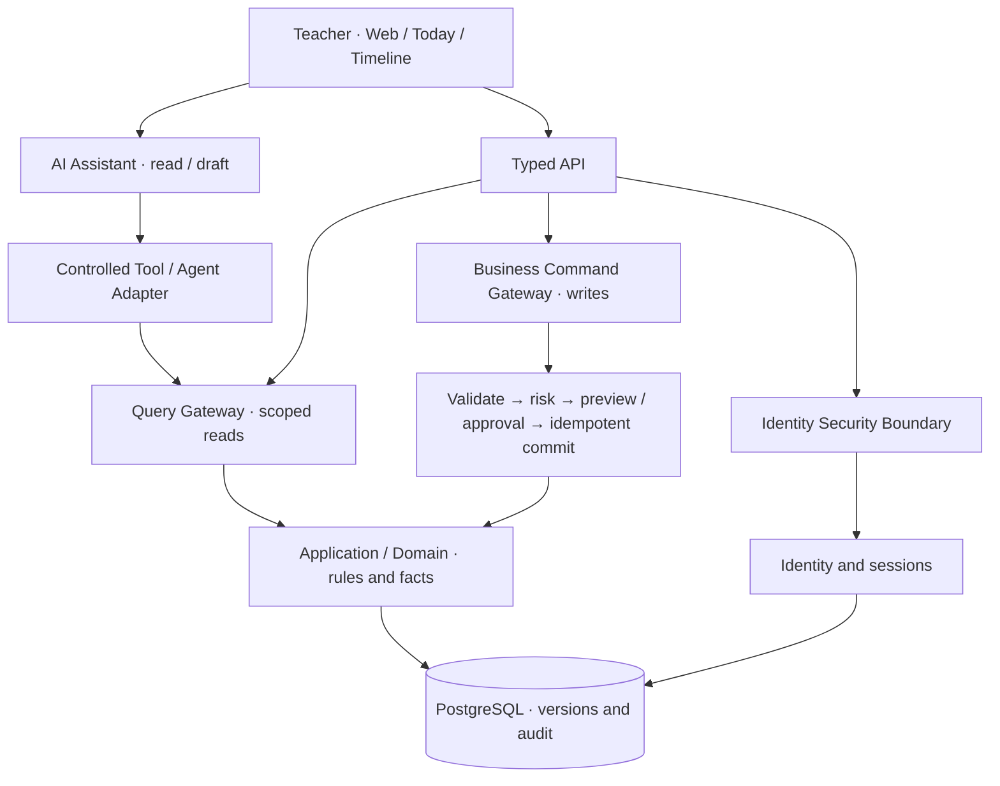

# ClassMatter · 班事有谱

**Every class matter matters.**

**An Agent-native Personal Class OS for homeroom teachers.** ClassMatter turns scattered observations, notes, messages and follow-ups into a coherent, traceable working context: what happened, what needs attention, what changed, and what was actually done.

[简体中文](README.md) · [Our philosophy](#six-product-principles) · [Product](#from-a-single-record-to-a-class-workspace) · [Architecture](#agent-native-without-ceding-authority-to-the-model) · [Quick start](#quick-start) · [Docs](#documentation)

> **Open Source · Pre-alpha · Apache-2.0.** The public repository contains a runnable synthetic-data development edition. Use of real student records or production operation requires separate admission.

## Why ClassMatter?

A homeroom teacher's job is not a collection of isolated forms. A late arrival, an absence, a conversation, or a missing assignment may lead to a next action, a deadline, a handoff, or a later correction. Yet much of that context lives across spreadsheets, messages, paper notes and someone's memory.

**We want the work to have a memory without making the teacher its storage engine.**

ClassMatter starts with an actionable, reviewable thread: **record → follow-up → Today → Student Timeline → correction and audit**. It is designed around continuity and accountability, not just digitizing a notebook.

## Six product principles

### 01 · The unit of work is a matter, not a table

An event has a subject, source, time and meaning; some events produce tasks; tasks have outcomes. A useful workspace preserves those relationships so information can be used again, not merely stored once.

### 02 · Reduce passive responsibility pressure, not just typing time

Notification overload, unclear ownership, missing handoffs and retrospective accountability are major sources of hidden work. Our priority questions are: **what happened, what action is required, why, by whom, by when, what is its status, and where is the evidence?**

An incoming message is not itself an accepted responsibility. The system supports understanding and traceability without assigning organizational or legal responsibility on the teacher's behalf.

### 03 · Facts, observations and AI inferences carry different authority

The model distinguishes **Domain Fact, Observation, Claim, Evidence, Derived Signal, AI Inference and Draft**. A model-generated hypothesis must not become a formal fact simply because it appeared in chat or memory.

Likewise, working context, conversation memory, knowledge, RAG indexes and canonical business data have different roles. Sources, validity and version matter.

### 04 · AI understands and assists; domain rules decide

AI is useful for understanding language, retrieving authorized context, explaining and drafting. Deterministic domain code owns validation, calculations and versioning. Trusted UI and gateways own permissions, risk, confirmation and business changes.

**The Agent is neither the system of record nor the authorizer.** Core workflows must keep working when the model is unavailable.

### 05 · Start with a stable core; evolve through governed domains

The long-term model follows **Stable Kernel → Domain Pack → Controlled Extension → Promotion**. Shared semantics cover scope, identity, temporal relationships, evidence and permissions. Specific domains—records, tasks, grades, seating and more—build on them.

No unbounded JSON fact warehouse and no autonomous Agent DDL. OCR, ASR, RAG, workflow engines and solvers remain replaceable capabilities, not owners of business truth.

### 06 · Optimize for net burden, not demo speed

Saving a minute of typing is not a win if it creates five minutes of verification, an overflowing review queue, or hidden operational risk. Our **Net Burden** perspective accounts for correction, onboarding, maintenance, error rates, safety and real outcomes.

A feature with no sustained net value should be redesigned, narrowed or removed—even if its demo looks impressive.

## From a single record to a class workspace

| Scenario | Product direction |
| --- | --- |
| Workspace and roster | Establish a consistent class, term and student identity context |
| Daily records | Keep typed facts with time and source rather than unstructured fragments |
| Tasks and Today | Turn follow-ups into an actionable view of the next step |
| Student Timeline | Reconstruct context and progress over time |
| Corrections and audit | Preview and approve changes as needed; preserve versions and traceability |
| AI-assisted work | Ground queries and drafts in authorized data without autonomous approval or formal writes |
| Expanding domains | Grades, seating, dormitory, reports, communication and governed capture/collaboration |

**Implemented vertical slice:** single-owner local workspace, class/term/roster, typed records, tasks, Today, Student Timeline, correction preview/approval, audit/version handling, and a replaceable Pydantic AI query/draft adapter. These are supported by code, migrations, contracts and synthetic integration tests.

**Full product blueprint:** import and analysis, constraint-based arrangements, reporting, communication, knowledge and memory boundaries, capture/entity resolution, workflow and multi-role collaboration. They are designed in the project specifications, not represented as already shipping features.

See [Requirements](docs/specs/class-os-v1/requirements.md), [Business Flows](docs/specs/class-os-v1/business-flow.md), [Long-term Evolution](docs/specs/class-os-v1/long-term-requirements.md) and [Release 1 scope](docs/specs/class-os-v1/release-1-manifest.md).

## Agent-native without ceding authority to the model



The system uses **React 19 / TypeScript / Vite / Tailwind CSS** and **Python 3.13 / FastAPI / PostgreSQL 18**, built as a layered modular monolith with an optional Pydantic AI adapter. Internal `class_os` identifiers remain for compatibility.

See [Architecture](docs/specs/class-os-v1/architecture.md), [Architecture Decisions](docs/specs/class-os-v1/architecture-decision.md) and [Engineering Overview](docs/ENGINEERING_OVERVIEW.md).

## Quick start

The supported persistent local runtime currently requires **Windows and DPAPI**, with PowerShell 7, Node.js 22–24, pnpm 11.19.0, Python 3.13, uv 0.11.7 and PostgreSQL 18.6 binaries.

```powershell
cd apps/web
pnpm install --frozen-lockfile
pnpm typecheck
pnpm build

cd ../../backend
uv sync --frozen
uv run --frozen python local.py init --pg-root '<PostgreSQL18 installation directory>'
uv run --frozen python local.py start
uv run --frozen python local.py bootstrap
uv run --frozen python local.py serve
```

Open **http://127.0.0.1:8000**. Keep credentials and recovery codes out of Git. Stop the owned database with `uv run --frozen python local.py stop`. Existing installations require an explicit migration; do not copy `.local-runtime/` between machines. The Vite mock (`VITE_CLASS_OS_DEMO=true`) is not the persistent service.

## Engineering and project stage

```powershell
python scripts/public_guard.py --require-license
pwsh ./scripts/verify.ps1 -Suite all -PostgresRoot '<PostgreSQL18 installation directory>'
```

The repo includes pinned dependencies, Windows/Ubuntu CI, contract tests, disposable real PostgreSQL and browser regressions, and a SHA-256 allowlist for every public file. See [Public Audit](docs/PUBLIC_AUDIT.md).

The public edition is **Pre-alpha / synthetic development**. Production, real-student-data processing, formal R1, representative teacher validation and cross-host recovery require separate evidence and admission. The product vision is broader than the current verified feature slice.

## Documentation

[Product Requirements](docs/specs/class-os-v1/requirements.md) · [Business Flows](docs/specs/class-os-v1/business-flow.md) · [Long-term Requirements](docs/specs/class-os-v1/long-term-requirements.md) · [Value and Acceptance](docs/specs/class-os-v1/acceptance.md) · [Release Scope](docs/specs/class-os-v1/release-1-manifest.md) · [Contributing](CONTRIBUTING.md) · [Security](SECURITY.md)

---

**ClassMatter is not about making teachers remember more. It's about giving important work a traceable place to live.**

Project-owned code is licensed under [Apache-2.0](LICENSE), Copyright 2026 Gdnbit; third-party terms are listed in [NOTICE](NOTICE) and [THIRD_PARTY_NOTICES](THIRD_PARTY_NOTICES.md). This is an independently exported public repository without the original private development history or private research material.
