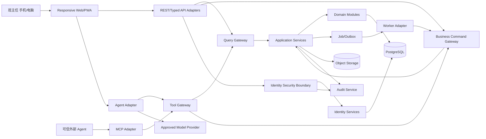

# Architecture: ClassMatter v1

2026-10-15 原R1实现增量（FR-CLS-001、T-RDOM-011/T-RWEB-006）：当前学期元数据更正保持roster所有权，term.update以Term自身版本/旧name/start/end做CAS，经现有BCG预览/批准/提交/W2/幂等/事务审计。独立QG metadata投影复用class.context审计并绑定class/term/resource/version；不扩context.v1、不加Agent写Tool。只更正元数据，不重分配历史事实/Enrollment、不按日期切学期或改变授权；多班级/多学期/Calendar仍不进入R1。显式变化为risk r1.3、固定迁移0016与runtime三列授权，22表不变；不是Task/Eval/Gate晋升。详见 [开发登记](../../changes/2026-10-08-synthetic-development-admission.md)。

> 文档状态（2026-10-08）：现行规格/规划/规则；设计存在；实现/批准须另凭目标版本证据。项目完成度见 [公开工程边界说明](../../ENGINEERING_OVERVIEW.md)；本标识不提升批准、测试或任务状态。

状态：`proposed`，已整合开放世界长期不变量，仍需完成 `architecture-confirmation.md` 后批准。\
架构风格：分层模块化单体 + 独立后台 worker；Agent 和外部 MCP 是适配器，不是事实层。

## 1. Context



## 2. Container Responsibilities

| 容器 | 责任 | 明确禁止 |
|---|---|---|
| Web/PWA | 直接 UI、Agent 面板、预览确认、响应式交互、短期离线草案 | 客户端独立授权；保存长期明文敏感缓存 |
| REST/Typed API Adapters | 解析请求并分类到 Query、Business Command 或 Identity Security 边界 | 直接调用 repository；保留未分类写入口 |
| Query Gateway | 授权、scope、最小投影、D2+ 先审计后释放 | 产生任何业务或身份副作用 |
| Business Command Gateway | 正常业务命令执行 admission、授权、风险、批准、幂等、版本、事务审计；唯一 `ScopeAllocationCommand` 走受限 pre-admission 分支 | 处理 bootstrap/recovery；允许其他 pre-admission 命令或 adapter/worker 旁路 |
| Identity Security Boundary | bootstrap、登录/登出、恢复码、凭据轮换、session 吊销的限速、幂等与安全审计 | 读写学生业务数据；绕过身份恢复策略 |
| Domain Modules | 聚合、不变量、确定性计算、状态转换 | 调用 LLM、依赖 Web 组件 |
| Tool Gateway | Tool schema、授权和结果包装；R1 只转发查询/草稿 | 暴露 approve；直接调用 repository；绕过 Query/Business Command Gateway |
| Agent Adapter | 会话、工具循环、上下文最小化、模型 provider adapter | 成为 System of Record |
| MCP Adapter | 对可信客户端公开允许列表能力 | 默认公开全部内部 Tool |
| Worker | 执行已登记 outbox 工作并经 Business Command Gateway 提交业务副作用 | 直接写 repository；执行未分类任务 |
| PostgreSQL | 规范化事实、版本、任务、批准、审计索引、outbox；后续仅保存经 BCG 建立的受控 logical extension metadata | 把模型长期记忆当作业务表；由 Agent/Connector/Workflow 直写；运行时执行 DDL |
| Object Storage | 原始隔离上传、正式附件、导出、备份对象 | 公共匿名 bucket |
| Audit Service | 业务审计事件、检索、保留和完整性 | 记录不必要敏感正文 |

## 3. Layering

```text
presentation
  ├─ web UI
  ├─ REST/typed API
  ├─ agent adapter
  └─ MCP adapter
application
  ├─ commands / queries
  ├─ approval orchestration
  ├─ import/export jobs
  └─ transaction / outbox coordination
domain
  ├─ stable semantic kernel (scope / party refs / time / provenance / policy)
  ├─ class & roster
  ├─ events & tasks
  ├─ exams & grades
  ├─ seating & groups
  ├─ dormitory & positions
  ├─ reports & communication drafts
  └─ authorization policy vocabulary
infrastructure
  ├─ database repositories
  ├─ object storage
  ├─ identity provider
  ├─ model provider
  ├─ file parsers/renderers
  └─ telemetry / backup
```

依赖只向内。领域层不导入 FastAPI、React、数据库 ORM、OpenAI SDK、AG-UI 或 MCP 类型。

## 4. Command and Query Model

- 所有入口先分类为 Query、Business Command 或 Identity Security Command；未知/未分类入口固定拒绝。
- Query 返回领域 DTO 和显式数据新鲜度，不产生业务副作用，经 Query Gateway 执行 scope 与敏感读审计。
- Business Command 必须包含 `command_id`、`idempotency_key`、`actor`、`workspace_id`、`expected_version`、`reason` 和 payload，并且只经 Business Command Gateway。
- `ScopeAllocationCommand` 是 Business Command Gateway 中唯一的 pre-admission command type：只在已认证 owner 的既有 synthetic workspace 内，验证绑定 release/deployment/owner/workspace 和完整 readiness 报告的单次 setup capability；原子消费 capability 后只写不含个人数据的 `ScopeAllocation` aggregate 与耐久 ledger，预留 class_id/term_id。它不得创建 Class、AcademicTerm、Student、Record、Task 或开启通用业务写；任何其他 pre-admission command/type/field 固定拒绝。
- Identity Security Command 不假设已有 workspace/admission，但必须经独立 Identity Security Boundary 执行限速、一次性能力、幂等、事务和安全审计；不得读写学生业务聚合。
- W2/X Command 先生成 `ChangeProposal`，校验后形成 `ApprovalRequest`；批准 token 绑定 proposal hash、actor、scope、version 和 expiry。
- Approval 只接受受信 Web UI 中已认证用户的明确动作，approve endpoint 不进入 Agent/Skill/MCP Tool catalog；该信号证明认证通道与会话绑定，不单独证明人的物理在场。X 级操作需要近期重认证或另行批准的强认证因素。批准额外绑定认证会话、客户端实例和 CSRF nonce，并只能消费一次。
- 提交在单一数据库事务中完成：业务变更、版本递增、outbox、审计摘要。
- 外部副作用由 outbox worker 执行，记录 attempt、receipt 和补偿状态。

## 5. Data Ownership

每个聚合只有一个写入模块：

| 聚合 | 写入拥有者 | 允许的跨模块引用 |
|---|---|---|
| Workspace/User/Membership/AuthorityGrant/PolicySet | identity-access | user_id/workspace_id；唯一 authorize port |
| Person/Organization/RoleBinding/Responsibility/Availability/Relationship/Assignment | party-organization（后续 release） | person/org refs；只提供描述事实，不自行授权，专业正文不复制 |
| Class/Term/Enrollment/Student/Guardian | roster | student_id/class_id/term_id |
| Event/Attendance/HomeworkRecord | records | record_id + student_id |
| Task/FollowUp | tasks | task_id + source ref |
| Exam/Subject/Score/MetricSnapshot | grades | exam_id/score_id/read model |
| Location/Slot/SeatAssignment | seating | assignment_id/read model |
| Dorm/Bed/DormAssignment | dormitory | assignment_id/read model |
| Position/PositionAssignment/Group/Duty | organization | assignment refs |
| ReportDraft/CommunicationDraft | reporting | source refs only，不复制事实 |
| ImportBatch/ExportJob | interchange | target aggregate refs |
| Proposal/Approval/ToolInvocation | capabilities | target refs + hashes |
| ScopeAllocation | capabilities | workspace_id + reserved class_id/term_id + setup artifact/ledger refs；不是 Class/Term 业务实体 |
| AuditEvent | audit | immutable resource refs |
| ChannelEnvelope/CaptureSession/CaptureDraft/ResolutionCandidate | capture（后续 release） | source refs；只有经 BCG 的 typed Command 可写 owning domain |
| KnowledgeDocument/Version/Citation | knowledge（后续 release） | source/version refs；不覆盖 Domain Fact |
| CustomType/SchemaProposal/PromotionRecord | extension-governance（后续 release） | logical schema metadata；所有状态变更经 BCG，物理迁移不由运行时执行 |

## 6. Consistency

- 单聚合和同一业务事务使用强一致。
- 跨模块派生视图通过 transactional outbox 最终一致，并显示 `as_of`。
- 批量导入使用 staging + validation + transaction；不直接逐行写正式表。
- 报告和 Agent 回答读取带版本的快照，提交时重新验证。
- 附件先隔离扫描，再发布对象引用；数据库事务失败时清理/隔离孤儿对象。

## 7. Agent Boundary

Runtime、Jev、Tool 分类、实时事件和 Session/Memory 的实现级边界详见 [公开工程边界说明](../../ENGINEERING_OVERVIEW.md)。该专题解释本节，不新增写入口或 R1 功能。

```text
User message
→ deterministic capability filter（静态 allowlist/risk metadata）
→ optional Jev typed route（意图/领域/歧义，不是授权）
→ primary model（自然语言、复杂参数、回答）
→ Intent Catalog resolution + requested scope（不是授权）
→ Context policy selects minimum fields
→ Skill guides sequencing
→ Tool Gateway validates schema and policy
→ Application Service executes query/proposal/command
→ UI renders allowlisted component
→ Approval Service gates write
→ Audit correlates model/tool/business events
```

Agent 运行时可替换。会话摘要只帮助对话连贯，不自动成为学生事实；要保存的信息必须通过显式 Tool、认识论类型标注、领域校验和 BCG。ActiveContext 只能表达当前选择，不能扩大 `identity-access` 的 AuthorityGrant/PolicySet。

## 8. Offline and Weak Network

- v1 不做完整离线数据库同步。
- Release 1 不在 localStorage/IndexedDB 持久化 D2+ 草稿，只允许页面内存恢复；登出、会话过期或关闭页面即清除。
- 在线提交前生成服务器认可的幂等键；超时后查询 command status，禁止盲目重发新 key。
- 冲突以服务器版本为准，展示人工重新输入/核对，不做 last-write-wins。
- 若未来需要持久离线草稿，必须独立设计密钥、共享/丢失设备、TTL、登出清除和恢复语义，并通过单独 ADR/eval。

## 9. Deployment Shape

Release 1 只支持一个经批准的单主机容器化拓扑：反向代理、Web/API、worker、PostgreSQL、受控文件卷 adapter、备份任务和监控；因首切片无附件，不强制 S3。真实试点前必须有资源下限、安装、自检、升级、回滚、证书、备份恢复、支持包和退役流程。

## 10. Sensitive Read Audit

- Release 1 的 D2/D3/D4 学生详情、Timeline、事件列表、模型投影和敏感导出在响应释放前取得耐久 audit receipt；失败时 fail closed。
- D0/D1 技术健康查询可使用最小本地 durable buffer；Release 1 不存在可异步缓冲的 D2 学生数据读取例外。
- audit 查询有独立权限和字段投影，访问 audit 本身也产生 audit。
- audit 正文只保存必要资源引用、目的、摘要/hash 和结果，不复制完整敏感 payload。

## 11. Command、Risk and Approval Choke Point

所有学生/班级业务写入 adapter 必须进入同一个 Business Command Gateway；Web route、REST、内部 service、worker、Agent Tool 和未来 CLI 不得直接调用 repository。Gateway 先按 allowlist command type 分支：

```text
ScopeAllocationCommand only:
synthetic-only + auth/workspace → setup signature/reports → exact schema
→ fixed risk/idempotency → atomically consume capability
→ write ScopeAllocation + durable ledger/audit (no Class/Term/Student/business entity)

all normal Business Commands:
admission → auth/workspace/scope → schema → risk → idempotency/version
→ W1: explicit commit
→ W2/X: proposal → trusted approval endpoint → consume-once commit
→ business write + durable audit in one transaction
```

- W2/X commit 缺少已验证 approval receipt 时固定拒绝；前端出现确认卡不构成安全控制。
- Approval Service 独立于 Agent runtime；Release 1 的 Agent 没有业务写 Tool，Agent SDK HITL 不属于核心写入依赖。
- `approve` 不在 Tool/Skill/MCP catalog。服务器只验证通道、认证、绑定、时效和单次消费，不声称普通浏览器事件可证明人的物理在场。
- 需要 X 级强在场时使用经批准的近期再认证或 WebAuthn/二次验证；Release 1 不实现 X 级业务动作。
- bootstrap、凭据恢复和 session 吊销是明确的非业务写例外，但只能进入 Identity Security Boundary；数据库脚本、worker、REST controller 直写身份表同样禁止。除 Query/Business Command/Identity Security 三类边界外不存在第四类写入口。
- pre-admission 不是第四边界或通用跳过开关：只有 schema 中固定的 `ScopeAllocationCommand` 可在 Business Command Gateway 内进入该分支。未知 command、附加字段、非空业务 payload、未绑定 workspace、重复 capability 或尝试写任一业务 aggregate 均 fail closed。

## 12. Real-data Admission

- 部署初始且默认状态为 `synthetic-only`；此状态只能运行标记为合成的 fixture/workspace。
- 两阶段 bootstrap 的 setup payload 绑定 release digest、deployment id、owner、`workspace_id` 及 candidate/pilot-readiness/shadow-value 引用；它只能经 BCG 的 `ScopeAllocationCommand` 预留 ID 并产生绑定 target commit/environment 与耐久 ledger proof 的 receipt。
- `approved-real-pilot` 必须加载由应用外批准者签名的最终 artifact，绑定 release digest、deployment id、owner、`workspace_id`、allocation receipt、class、academic term、expiry、allowed modules 和已验真的批准证据引用。
- Command Gateway 在每次业务写前验证 artifact；缺失、范围不符、过期或撤回均 fail closed，并产生不含学生正文的安全信号。
- 撤回不阻止授权退出导出；不允许应用自身签发、延长或扩大 artifact。
- 准入切换、拒绝、到期和撤回进入不可由普通用户修改的审计链。

## 13. Evolution Rules

- 先交付事件闭环的垂直切片，再复用平台能力到成绩和排座。
- 模块跨进程拆分只有在独立伸缩、隔离、团队所有权或合规边界有证据时考虑。
- 多 Agent 只有在单 Agent eval 显示稳定失败且职责隔离能改善指标时考虑。
- 任何新的外部集成先以 adapter + contract test 接入，不将供应商对象作为领域模型。
- 新领域固定按“复用 Canonical Ontology → 配置 Domain Pack → Controlled Extension → 经证据 Promotion”演进；禁止万能 JSON/Fact 表和 Agent Schema mutation。
- Harness、OCR、ASR、RAG、Artifact renderer、workflow runtime、connector runner 和 solver 只作为 Shared Capability，通过稳定 port 接入，不进入业务 Stable Kernel。
- Channel/Capture 只能生成 Draft/Candidate/Proposal；Memory、Knowledge、Workflow、Extension 的持久化状态同样属于业务 Command，必须经过 BCG。
- 长期语义详见 [公开工程边界说明](../../ENGINEERING_OVERVIEW.md)。

## 14. Release 1 准入实现收敛（第六轮整改）

这里细化第 4/11/12 节的“原子消费”，不增加新的业务入口。

- 外部签发/撤销清单只声明 issued/revoked，不执行 setup 的 consumed CAS。消费事实唯一存于本部署 PostgreSQL。
- 在一个数据库事务内写入 setup consumption、ScopeAllocation、ledger、audit 和不可变 receipt payload；唯一约束为 `(deployment_id, setup_artifact_id)`。同一授权请求重试只返回原 receipt，payload/owner/workspace 不同则冲突拒绝；没有第二次分配。
- receipt 的签名与网络交付在提交后完成。签名器或响应失败只重试已提交 payload 的签名/交付，不重新分配；提交前任一故障全部回滚。不得通过“先消费外部清单，再写本地库”假装分布式原子性。
- 每次执行验证当前签发/撤销快照，将 generation/hash 写入本地 ledger。R1 使用受控部署中的只读版本化文件，不建设在线 registry 服务。generation 同时覆盖角色密钥与 artifact 的签发/撤销状态。
- 初始 generation=1、previous hash=null；更新必须 generation=current+1 且 previous hash=当前 pin。已 pin 的离线 root 验签、security/operations 批准后，停止所有 API/worker 写入并排空事务，再原子替换受 OS 权限保护的 pin 与快照引用，重启验真后恢复写入。不做热更新。旧 generation、同代异 hash、断链、过期或无法读取均禁写；部署恢复也不得降低 pin。
- 撤销的生效边界是上述激活完成，而非上游发出撤销请求的瞬间。紧急撤销先停全部写入；不能完成激活就保持停写。快照过期自动禁写。此方案接受短维护窗口，运维任务必须测量停写/激活时间，不承诺零延迟在线撤销。
- 主机 root/DBA 为受信运维角色；本机制不声称抵御其替换运行时或整盘回滚。该边界不得在宣传中扩大。

T-REVAL-019 已完成组件减法：删除 `CLASS-OS-SIGNATURE-V1` 自定义 framing，统一采用 DSSE v1 envelope。verifier 先以维护中的 in-toto/securesystemslib 对 exact `payloadType` + payload bytes 验签，再严格解析并重现 RFC 8785 canonical JSON；角色、quorum、key status/usage、有效期、撤回、registry generation/hash、strict per-type schema、nested context binding 和 lifecycle 由 ClassMatter policy 验证，DSSE `keyid` 仅作未认证 lookup hint。GitHub/Sigstore attestation 仅复用为 CI build/evidence provenance，不能替代业务准入。运行时目标仍只有一个本地 verifier、一个受保护的外部 registry/root pin，以及 setup 的本地消费事务；不新增在线 registry/signing service 或按 artifact 拆分的审批服务。T-REVAL-020 follow-on 已把 port 接到 bounded rooted local artifact store、payload digest 与同一 DSSE/policy verifier，并证明 typed nested reference 的 cycle/depth/node fail-closed；candidate/pilot gate report 绑定不同 gate ID 且定义为 release/environment 级，workspace 只由 shadow/receipt/admission 等相应 artifact 绑定。非空通用引用必须在父制品中签入有序 ID/type/digest 和 catalog ID/URI/digest；release-verifier 签名的 catalog 只提供 ID→URI，目标仍须独立验签并匹配父制品绑定，公共 admission 缺少闭包端口即拒绝。`PostgresIdentityLedger` 以数据库主键与 unique nonce 证明全局 artifact identity 的并发、重启持久和 outage fail-closed；它不是 setup consumption。Windows 扁平本地 artifact root 的 synthetic native final-component no-follow 已证明；生产 root/父目录 ACL、轮换与部署自检仍待证明。官方 DSSE PAE、RFC 8032 Ed25519、RFC 8785 与所有 mutation 由 `spikes/signature-envelope/` 复现。production authorization 继续为 `false`，正式签发/撤回仪式与外部批准不得由开发证据冒充。

T-REVAL-020 的隔离合成 follow-on 已证明五表同一 PostgreSQL 事务、唯一/复合外键/不可变触发器与精确 schema 合同、受限 writer、提交前故障全回滚、并发同请求一次分配、冲突与被篡改回执拒绝、重启投影一致及停库 fail-closed。它不是生产 Business Command Gateway 接线：fixture 构造的 `VerifiedArtifactReference`、registry 与 `TrustedAllocationContext` 必须在正式实现中由受信 DSSE verifier、激活快照和主体认证提供，adapter 不得被 API、Agent、worker 直接调用。receipt 签名和交付仍需正式集成证明。五表仅保存最小 owner 身份范围元数据，不保存学生业务事实；其中 ledger entry 不包含 owner IDs，不能把整组表误称为“无个人数据”。此验证不改变 R-ADM-001、E-ADM-007—009、T-RPLT-012 的生产验收状态，也不放宽 `before_feature_task`。

## 15. Canonical Semantic Families

长期模型按以下语义族组织，而不是用一个万能根表替代 typed domain：

```text
Scope & Identity
Party & Organization
Temporal Relationship & Assignment
Truth & Evidence
Work & Temporal
Communication / Knowledge / Artifact / Capture
Extension Governance
```

每个对象横切携带 scope、source/provenance、recorded/valid time、version/status、sensitivity/purpose、retention、owner 和 audit。`EventOccurrence`（现实事件）、`ScheduleItem`（计划）、`DomainEvent`（系统集成事件）不得混用；`RoleBinding`、`ResponsibilityAssignment`、`AuthorityGrant` 和 `Availability` 不得互相推导。

## 16. Future Capture and Extension Flow

```text
Channel Adapter
→ ChannelEnvelope
→ CaptureDraft / ResolutionCandidate
→ deterministic validation / human review
→ typed Business Command
→ Business Command Gateway
→ owning Domain Module
```

```text
reuse core/domain pack
→ SchemaProposal
→ policy + lifecycle + migration + rollback review
→ Extension Service
→ Business Command Gateway
→ versioned logical schema metadata
```

OCR/ASR/LLM confidence 只影响候选排序，不授予权限。Agent 不执行 DDL；物理迁移由 CI/CD 中的版本化发布执行。AI Inbox/Review Inbox 只是 Draft/Candidate/Conflict 的投影，不是第四写入口。

## 17. Release Applicability

上述第 15—16 节是长期架构约束，**不改变 `class-os-r1`**。R1 继续只有单 owner、一个班/学期、手工 roster、事实事件、简单任务、Today/Timeline、退出和 Agent 查询/草稿；微信、文件/图片 Capture、Audio/Ambient、Guardian、多角色、Group、Knowledge、Dynamic Schema、Scheduling 与实际外发均不注册。
